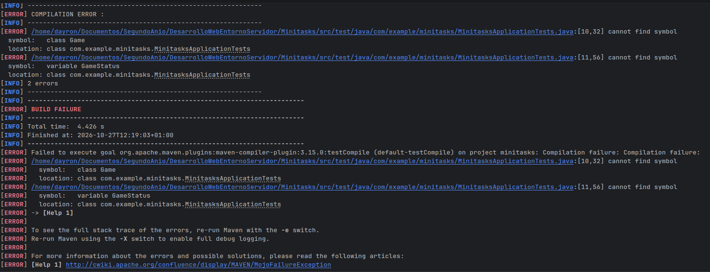
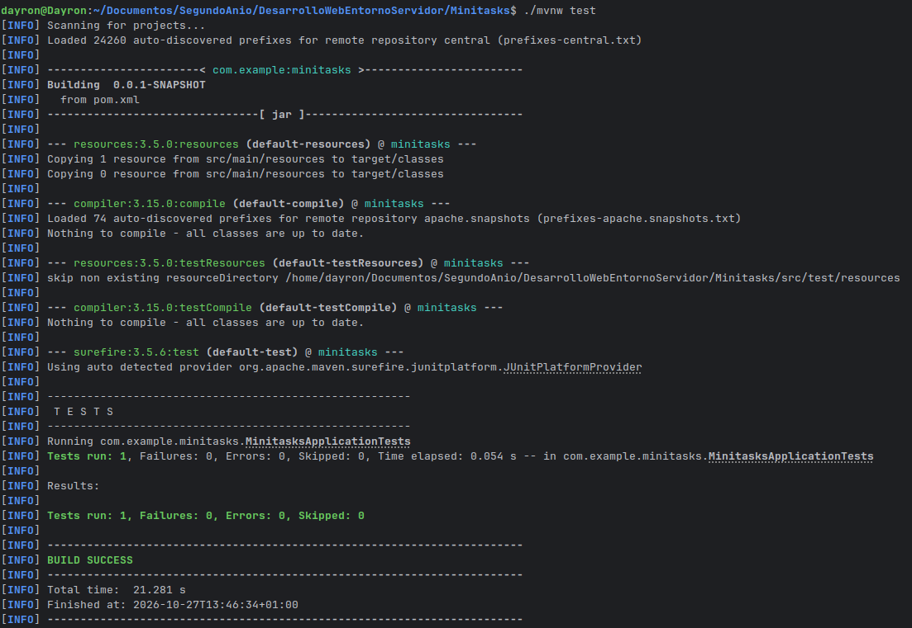
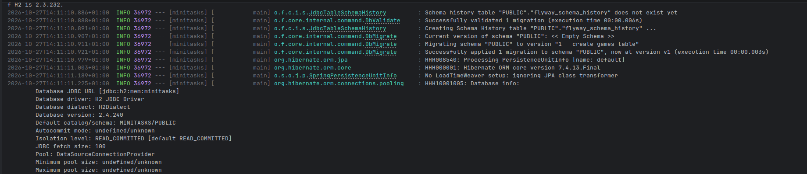
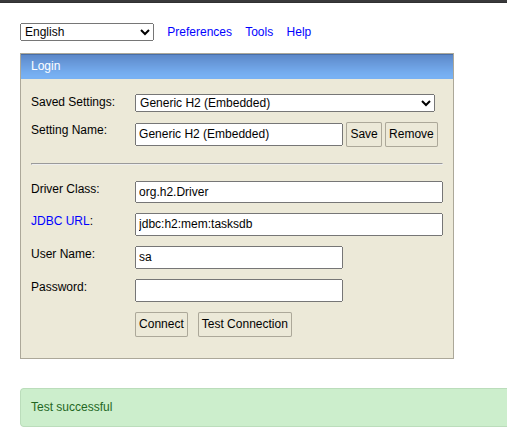
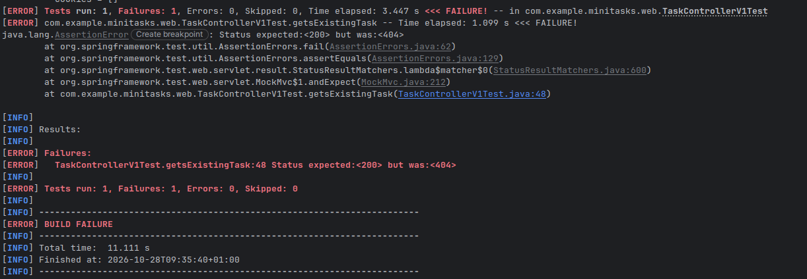
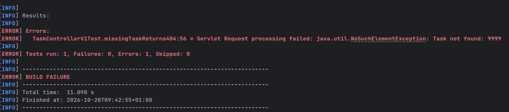
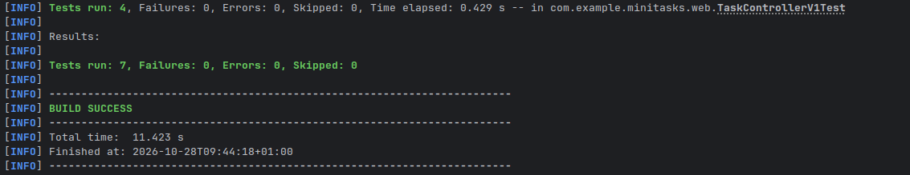

# Minitasks

## Sesión 2

## Evidencias

## 1. Rojo — el test que falla

El test se escribe **antes** de crear la entidad:

```java
package com.example.minitasks.entities;

import org.junit.jupiter.api.Test;

import static org.assertj.core.api.Assertions.assertThat;

class TaskTest {

    @Test
    void newTaskShouldNotBeCompleted() {
        var task = new Task("Comprar leche");

        assertThat(task.getTitle()).isEqualTo("Comprar leche");
        assertThat(task.isCompleted()).isFalse();
    }
}
```

Al ejecutarlo por primera vez **no compila** porque `Task` todavía no existe:
ese es el rojo del ciclo.



## 2. Verde — lo mínimo para compilar y pasar

Se crea la entidad `Task` con los tres campos pedidos y el estado inicial a
`false`:

```java
@Entity
@Table(name = "tasks")
public class Task {

    @Id
    @GeneratedValue(strategy = GenerationType.IDENTITY)
    private Long id;

    @Column(nullable = false)
    private String title;

    @Column(nullable = false)
    private boolean completed = false;

    public Task() {
    }

    public Task(String title) {
        this.title = title;
    }


    public boolean isCompleted() {
        return completed;
    }

    public void setCompleted(boolean completed) {
        this.completed = completed;
    }
}
```

Se vuelve a ejecutar el test y pasa:



## 3. Migración Flyway

Archivo: `src/main/resources/db/migration/V1__create_tasks_table.sql`

```sql
CREATE TABLE tasks (
    id BIGINT GENERATED BY DEFAULT AS IDENTITY PRIMARY KEY,
    title VARCHAR(255) NOT NULL,
    completed BOOLEAN NOT NULL DEFAULT FALSE
);
```

Hibernate está configurado con `ddl-auto: none`; el esquema lo crea Flyway.
Al arrancar, la migración se aplica correctamente:

```text
Successfully applied 1 migration to schema "PUBLIC", now at version v1
```

La tabla resultante puede comprobarse en la consola H2
(`jdbc:h2:mem:tasksdb`, usuario `sa`, contraseña vacía).



Comprobar conexion DB



---

## Sesión 3

## Evidencias

### 1. Rojo — `GET /v1/tasks/{id}` todavía no existe

Se escribe el test **antes** de la ruta. Crea la tarea y la consulta dentro del
mismo test, sin depender de otros métodos:



### 2. Rojo — una tarea inexistente no devuelve 404



### 3. Verde — `ResponseEntity` traduce el `Optional` vacío a 404

El método de consulta devuelve `ResponseEntity` y conserva el caso anterior:



### 4. Comprobación HTTP


```bash
curl -i -X POST http://localhost:8080/v1/tasks \
  -H "Content-Type: application/json" \
  -d '{"title":"Repasar controladores"}'
```

```text
HTTP/1.1 201
{"id":1,"title":"Repasar controladores","done":false}
```

```bash
curl http://localhost:8080/v1/tasks
curl http://localhost:8080/v1/tasks/1
```

```text
[{"id":1,"title":"Repasar controladores","done":false}]
{"id":1,"title":"Repasar controladores","done":false}
```

```bash
curl -i http://localhost:8080/v1/tasks/999
```

```text
HTTP/1.1 404
```

```bash
curl -i -X POST http://localhost:8080/v2/tasks \
  -H "Content-Type: application/json" \
  -d '{"title":"Tarea V2"}'
```

```text
HTTP/1.1 201
Location: /v2/tasks/1
{"id":1,"title":"Tarea V2","done":false}
```
---
